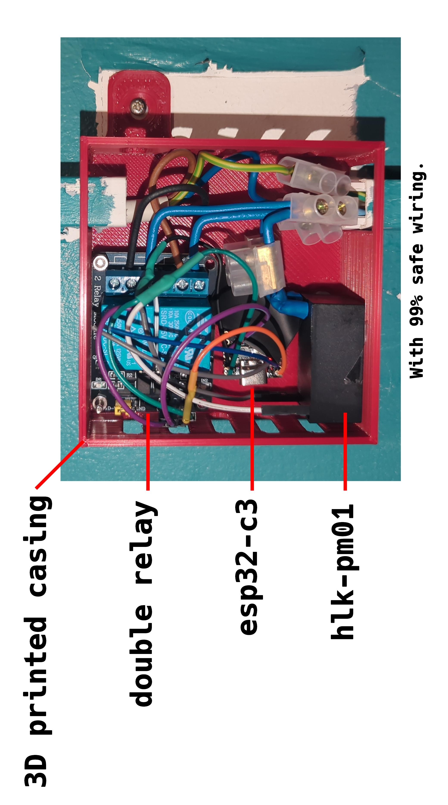

# Shutter Control — ESP32-C3

ESP-IDF firmware for an **ESP32-C3 Super Mini** that opens/closes an
electric roller shutter through two relays, on a schedule you set from a
web page on your local network:

- open/close schedule set from the page, **saved in flash (NVS)** so it
  survives reboots and power cuts;
- a switch on the page to pause / resume the schedule (also saved in flash);
- manual Open / Close / Stop buttons on the page, with live status;
- physical UP / DOWN push buttons (press = move, release = stop);
- the UP and DOWN relays are never energised together, and every
  movement stops automatically after `TRAVEL_SECONDS`.

<div align="center">
  
</div>

## How it matches your wiring

If your shutter's wall switch has three positions (UP / NEUTRAL / DOWN) that route
the same input current to either the "up" or "down" wire, this project
replaces that switch with **two relays** — one wired in place of the UP
contact, one in place of the DOWN contact:

- Both relays off → equivalent to NEUTRAL.
- UP relay on → equivalent to flipping the switch to UP.
- DOWN relay on → equivalent to flipping the switch to DOWN.

The code **never turns both relays on at once**, and always switches the
opposite relay off before energising the other one.

Each relay stays on for a fixed `TRAVEL_SECONDS` (15s by default) and then
switches off automatically. **Time this yourself** on the real shutter
(full close, full open) and set `TRAVEL_SECONDS` in
[main/config/config.h](main/config/config.h) a couple of seconds longer than the slowest
direction.

Physical buttons trigger an `opening` / `closing` action when pressed, then
a `stop` action on release.

## Wiring

| Function    | ESP32-C3 GPIO (default) | Replaces / role                         |
|-------------|-------------------------|-----------------------------------------|
| UP relay    | GPIO 4                  | "up" switch contact                     |
| DOWN relay  | GPIO 5                  | "down" switch contact                   |
| UP button   | GPIO 6                  | to GND when pressed (internal pull-up)  |
| DOWN button | GPIO 7                  | to GND when pressed (internal pull-up)  |

- Pins are set in [main/config/config.h](main/config/config.h). Avoid GPIO 2/8/9
  (strapping pins; 8 is the onboard LED, 9 the BOOT button), 18/19 (USB)
  and 20/21 (UART).
- Relays are **active-low** by default (GPIO at 0 = relay energised). For
  active-high modules set `RELAY_ACTIVE_LEVEL` to 1.
- The ESP32-C3 GPIOs are 3.3V: pick relay modules that can be triggered by
  a 3.3V signal (most solid state relays and opto-isolated modules can).

### Power supply

The ESP32 is powered from the same mains wires that feed the shutter, so
no second power source (USB charger, extra cable) is needed. A
**HLK-PM01** module (isolated AC-DC converter, 220V AC → 5V DC, 3W)
is wired in parallel on the shutter supply:

| HLK-PM01  | Connected to                    |
|-----------|---------------------------------|
| AC (L)    | live, from the shutter's supply |
| AC (N)    | neutral, from the shutter's supply |
| +Vo (5V)  | ESP32-C3 `5V` pin               |
| -Vo       | ESP32-C3 `GND`                  |

- The module needs **both live and neutral**: check that a neutral wire
  is available where the controller is installed (a shutter's wall switch
  box may only have the live and the up/down wires).
- **Don't plug the USB cable in while the board is powered by the
  HLK-PM01**: on the Super Mini the `5V` pin is tied to USB VBUS. Cut the
  mains power before flashing.

**Important:** mains wiring to the shutter motor is not something this
project can make safe by itself. If the motor runs on mains voltage and
you're not absolutely sure what you're doing please have your wiring
done or checked by a qualified electrician.

## Files

- [main/config/config.h](main/config/config.h) — pins, relay polarity, travel time, timezone, hostname, default schedule
- [main/config/wifi_config.h](main/config/wifi_config.h) — template for your Wi-Fi credentials
- [main/hardware/shutter_controller.c](main/hardware/shutter_controller.c) — relay logic with the up/down safety interlock
- [main/hardware/buttons.c](main/hardware/buttons.c) — debounced physical buttons
- [main/scheduling/scheduler.c](main/scheduling/scheduler.c) — checks the configured times every 5s
- [main/storage/settings_store.c](main/storage/settings_store.c) — schedule persisted in NVS
- [main/network/wifi.c](main/network/wifi.c) — Wi-Fi with auto-reconnect, NTP time sync, mDNS
- [main/web/web_server.c](main/web/web_server.c) — web page + JSON API
- [main/web/index.html](main/web/index.html) — the web page, embedded in the firmware

## Configure Wi-Fi

The board has no other way to receive network settings, so they are
compiled in.

Edit `WIFI_SSID` and `WIFI_PASSWORD` in `main/config/wifi_config.h`.
2.4 GHz networks only (WPA2/WPA3).

The timezone (default Europe/Paris, with automatic summer time) and NTP
server are set in [main/config/config.h](main/config/config.h). The clock is set over the
Internet by NTP: until it is, the schedule is paused but manual control
still works.

## Build and flash

With ESP-IDF v6.0 installed:

```bash
source ~/.espressif/tools/activate_idf_v6.0.2.sh
idf.py set-target esp32c3     # first time only
idf.py build
idf.py -p /dev/ttyACM0 flash monitor
```

The first build downloads the `espressif/mdns` and `espressif/cjson`
components. On boot the serial monitor shows the IP address and the clock
synchronisation.

Then from any device on the same LAN, visit:

```
http://shutter.local
```

or `http://<ip-address>` if your device doesn't support mDNS (some Android
versions). The IP is printed on the serial monitor and visible in your
router's client list under the name `shutter`.

## API

| Method | Path                      | Description                                  |
|--------|---------------------------|----------------------------------------------|
| GET    | `/`                       | web page                                     |
| GET    | `/api/status`             | relay state + schedule (JSON)                |
| POST   | `/api/settings`           | `{"open_time":"HH:MM","close_time":"HH:MM"}` |
| POST   | `/api/schedule`           | `{"enabled":true}` / `{"enabled":false}`: resume / pause the schedule |
| POST   | `/api/manual/open\|close\|stop` | manual control (409 if already moving) |

## Notes & limits

- **No login/authentication.** Anyone on your LAN can open the page and
  trigger the shutter. That's fine for a trusted home network, but don't
  port-forward this to the internet as-is.
- **No position feedback.** The controller doesn't know if the shutter is
  physically open or closed — only whether a relay is currently energised.
  After a power cut during travel, the position may not match what you
  expect; use the manual buttons to re-sync if needed.
- Pins, relay polarity and `TRAVEL_SECONDS` are changed in
  [main/config/config.h](main/config/config.h) (rebuild + reflash) — only the open/close
  times are exposed in the web page itself.
